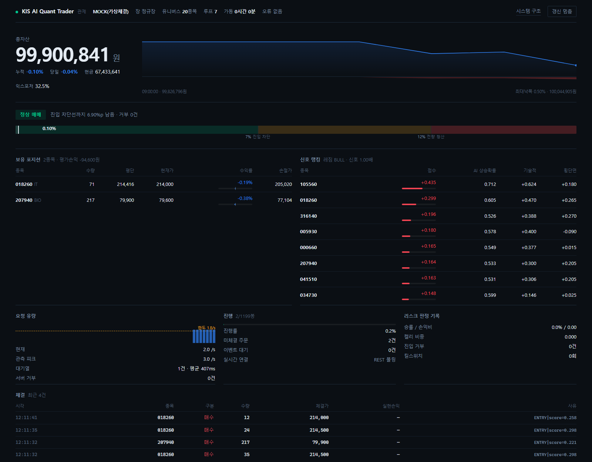

# KIS AI Quant Trader

한국투자증권 Open API로 대회 계좌에 실제 주문을 내는 자동매매 엔진입니다.
제16회 뱅키스 대학생 모의투자대회(AI 부문, 2026-10-12 ~ 11-20)에 참가하며 혼자 설계·구현·배포·운영했습니다.


> 모의투자 대회용 코드이며 투자 조언이 아닙니다. 실계좌에 연결해 생기는 손실은 사용자 책임입니다.



## 무엇을 했나

- **실서버 운영** — 네이버 클라우드 서버(2vCPU · 3.8GB)에서 systemd로 30거래일 실거래(11/19 기준 누적 +16.1%)
- **측정 = 실거래** — 진입·청산 판정은 순수 함수이고, 백테스트·측정 스크립트가 엔진과 같은 함수를 import 합니다
- **Mock ↔ 실서버 한 줄 전환** — 가상 체결 엔진이 증권사와 같은 응답을 흉내내, 계좌 없이 셀프테스트 27개 항목으로 전 경로를 검증합니다

## 운영 중 해결한 문제

| 문제 | 원인 | 해결 | 결과 |
|---|---|---|---|
| 기동하자마자 유량 초과 | 문서 한도(초당 2건)와 실제 한도가 다름 | 거절률을 직접 재 토큰 버킷을 초당 1건·버스트 1로 | 6분간 74회 → 0~3회 |
| 장 시작 판정이 305초 | 지연의 86%가 유량 대기 | 30종목 묶음 조회로 호출 수를 줄임 | 284호출 · 305초 → 10호출 · 19.8초 |
| 체결 통보가 엿새 동안 끊김 | 연결은 살아 있고 메시지만 멈춤(반쯤 열린 연결) | 장중 무음 180초 유휴 타임아웃으로 재연결 | 하루 체결 기록 0건 → 46건 |

자세한 진단 과정은 [docs/서버-운영-설계.md](docs/서버-운영-설계.md)·[docs/ARCHITECTURE.md](docs/ARCHITECTURE.md)에 있습니다.

## 구조

```
시세(복수시세 · WebSocket) ─▶ TradingEngine ─▶ 판정(strategy/, 순수 함수)
                                   │
                                   ▼
                     RiskManager — 모든 주문의 단일 관문
                                   ▼
                  우선순위 토큰 버킷(주문 > 계좌 > 시세)
                                   ▼
            Mock 가상 체결 엔진  ◀── 같은 인터페이스 ──▶  KIS REST
                                   ▼
                 체결 → 포트폴리오 → 원장(JSONL) → 관제 화면(/metrics)
```

| 영역 | 사용 |
|---|---|
| 런타임 | Python 3.13 · asyncio · httpx · websockets |
| 관제 | FastAPI · Prometheus 형식 지표 |
| 분석 | pandas · numpy · scikit-learn |
| 운영 | 네이버 클라우드 · systemd · chrony · logrotate |

## 실행

```bash
pip install -r requirements.txt
cp .env.example .env              # 기본값 USE_MOCK_MODE=true (계좌 없이 동작)

python scripts/selftest.py        # 셀프테스트 27개 항목
python main.py --duration 120     # Mock 실시간 루프 + 관제 화면 http://127.0.0.1:8500
```

실서버는 `.env`의 `USE_MOCK_MODE=false`와 KIS 앱 키·계좌번호만 바꾸면 됩니다.

## 폴더

```
main.py            엔진
config/            설정(.env)
core/              인증 · 유량 제어 · WebSocket · 이벤트
api/               증권사 클라이언트 · Mock 가상 체결 엔진
strategy/          판정 · 청산 규칙 · 리스크 관문
monitor/           관제 화면
scripts/           셀프테스트 · 데이터 수집 · 사전 점검 · 백테스트
scripts/research/  전략 측정·검증 실험(운영에는 쓰지 않음)
deploy/            서버 설치·배포
docs/              설계·전략·운영 문서
```

## 문서

- [docs/ARCHITECTURE.md](docs/ARCHITECTURE.md) — 코드 구조와 설계 결정
- [docs/매매전략.md](docs/매매전략.md) — 매매 규칙과 측정 결과(기각한 시도 포함)
- [docs/서버-운영-설계.md](docs/서버-운영-설계.md) — 서버·트래픽 운영과 장애 기록
- [docs/TODO-대회준비.md](docs/TODO-대회준비.md) — 날짜순 진행 기록

## 라이선스

[MIT](LICENSE)
