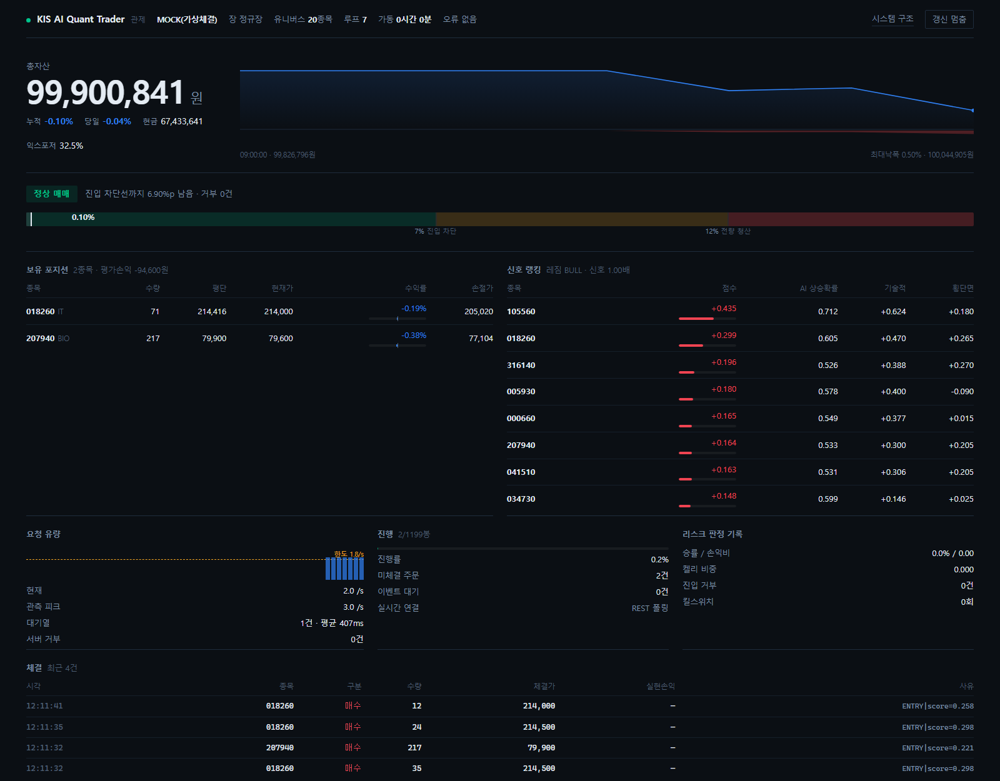

# 시스템 구조

제16회 뱅키스 대학생 모의투자대회(AI 부문) 자동매매 시스템의 구조 문서.

> **인터랙티브 다이어그램**: [`architecture.html`](architecture.html) — 브라우저로 열면 확대/이동,
> 경로 추적, 4개 가이드 뷰(시세 수집 · 판단 체인 · 리스크·유량 방어 · Mock 전환), PNG/SVG 내보내기를
> 쓸 수 있습니다. 매매 중이라면 <http://127.0.0.1:8500/architecture> 에서도 열립니다.


---

## 한 문장 요약

시세를 받아 44개 피처로 바꾸고, AI 앙상블이 점수를 매기면, **리스크 관문이 최종 수량을 결정**하고,
**유량 제어기를 반드시 통과해서** 주문이 나간다.

## 설계를 지배하는 세 가지 제약

### 1. 리스크가 최종 수량을 정한다

전략은 −1~1 점수만 낸다. 몇 주를 살지는 `strategy/risk_manager.py`가 결정하며, 거부권을 가진다.
대회 심사의 Sharpe와 MDD는 사실상 이 모듈의 품질로 결정되므로, 새 매수 경로를 추가하더라도
이 관문을 우회해선 안 된다.

| 계층 | 방어 장치 |
|---|---|
| 종목 | 고정 손절 3.5% · ATR 트레일링 · 익절 9% · 보유 30봉 시간 손절 · 급락 감지 |
| 포트폴리오 | 일일 손실 3% · 낙폭 7% 진입 차단 · 낙폭 12% 전량 청산 + 쿨다운 |
| 분산 | 종목 18% · 섹터 35% · 총 익스포저 90% · 최대 8종목 |
| 사이징 | 변동성 타게팅 × 켈리 배수 × 신호 강도 × 레짐 스케일 |

> 켈리는 **상한이 아니라 배수**다. 상한으로 쓰면 표본이 적을 때 상수값이 항상 이겨 변동성 타게팅이
> 무력화된다(구현 중 실제로 발생했던 버그).

### 2. 유량은 우회 경로가 없다

KIS는 계정 단위로 초당 요청을 제한한다(실전 20건, **모의투자 2건**). 넘기면 `EGW00201`이 발생하고
최악의 경우 손절 주문이 거부되어 리스크 관리가 통째로 무력화된다.

그래서 **Mock 호출까지 포함해 모든 REST 요청이 같은 토큰 버킷을 통과**한다. 실서버로 바꿔도
타이밍이 달라지지 않는다. 우선순위는 고정이다.

```
P0 주문·취소   ← 절대 지연 불가
P1 잔고·주문가능
P2 시세 조회   ← 아무리 몰려도 P0를 밀어내지 못한다
```

검증 결과: 시세 12건이 대기 중일 때 주문이 2번째로 처리됨(`scripts/selftest.py` 5번 항목).

### 3. 두 구현이 같은 계약을 지킨다

`api/mock_client.py`와 `api/client.py`는 `AbstractBroker`를 구현하고 **동일한 KIS JSON 스키마**
(`rt_cd`/`msg_cd`/`msg1`/`output*`)를 반환한다. 상위 레이어는 어느 쪽이 붙어 있는지 모른다.

덕분에 계좌 발급 전에 전 구간을 검증할 수 있고, 발급 후에는 `.env` 한 줄만 바꾸면 된다.

```ini
USE_MOCK_MODE=false
```

> 브로커에 메서드를 추가할 때는 **반드시 양쪽에 동시에** 구현해야 한다. `api/base.py`의 응답 파서를
> 양쪽이 공유하므로, Mock이 실제 KIS 필드명을 그대로 흉내내지 않으면 실서버 전환 때 깨진다.

---

## 데이터 흐름

| 단계 | 모듈 | 하는 일 |
|---|---|---|
| 수집 | `core/websocket_client.py` | H0STCNT0 체결·호가 스트리밍, 체결통보 AES 복호화, 끊기면 REST 폴백 |
| 수집 | `api/client.py` | 일봉·분봉·현재가·잔고 조회 (전부 유량 제어기 경유) |
| 인증 | `core/auth.py` | 토큰 24시간 캐시, 만료 30분 전 선제 재발급 |
| 가공 | `strategy/features.py` | 종목 피처 39종 + 횡단면 랭크 5종 = 44종 |
| 예측 | `strategy/ai_model.py` | 삼중배리어 라벨 → GBDT 학습 → 상승확률 |
| 판단 | `strategy/ai_model.py` | `0.5×AI + 0.3×기술적 + 0.2×횡단면`, 레짐 스케일 적용 |
| 통제 | `strategy/risk_manager.py` | 수량 확정 또는 거부, 청산 주문 생성 |
| 실행 | `main.py` | 주문 제출 → 체결 확인 → 포트폴리오 반영 |
| 기록 | `utils/logger.py` | 판정·주문·체결을 `logs/ledger.jsonl`에 남김 |
| 관측 | `monitor/app.py` | 2초 주기 상태 스냅샷을 관제 화면에 제공 |

## 룩어헤드 차단

백테스트 성과를 믿을 수 있어야 파라미터 튜닝이 의미를 갖는다. 세 지점에서 막는다.

1. `utils/indicators.py`의 모든 지표는 인과적이다. 전 구간에서 한 번 계산한 값과 시점마다 잘라서
   계산한 값이 같아야 하며, 셀프테스트 3번 항목이 이를 검증한다.
   **이 성질이 깨지면 백테스트의 사전계산 최적화가 곧바로 룩어헤드 버그가 된다.**
2. 백테스트는 봉 t 종가로 판단하고 봉 t+1 **시가**에 체결한다. 갭하락은 손절가가 아니라 시가 체결.
3. `backtest/data.py`의 `MarketSimulator`는 커서 이후 데이터를 노출하지 않는다.

## 백테스트와 실매매의 관계

`BacktestEngine`은 실매매와 **같은** `EnsembleAlphaStrategy`/`RiskManager` 인스턴스를 주입받는다.
전략·리스크를 고치면 양쪽에 동시에 반영되므로 불일치가 구조적으로 생기지 않는다. 갈라지는 지점은
두 곳뿐이다.

| | 백테스트 | 실매매 |
|---|---|---|
| 신호 | `precompute()` + `signals_at(i)` — 전 구간 1회 계산 O(n) | `generate_signals()` — 매 루프 마지막 봉 |
| 레짐 | `regime_series()` — 봉별 배열 | `detect_regime()` — 현재 시점 |

판정 규칙은 `_classify_regime()` 하나를, 점수 조립은 `_make_signal()` 하나를 공유한다.

---

## 관제 화면



`python main.py` 실행 중 <http://127.0.0.1:8500> 에서 열린다.

화면 규칙 세 가지:

- 등락 색은 **국내 시장 관습**을 따른다 — 상승 빨강, 하락 파랑.
- 초록은 가격이 아니라 '시스템이 살아 있다'는 신호로만 쓴다.
- 화면의 주인공은 **낙폭 게이지**다. 현재 낙폭이 진입 차단선(7%)과 전량 청산선(12%) 사이
  어디쯤인지를 한눈에 보여준다. 대회 심사의 핵심이 MDD 방어이기 때문이다.

| 경로 | 용도 |
|---|---|
| `/` | 관제 화면 |
| `/architecture` | 이 구조 다이어그램 |
| `/health` | 프로세스 감시용 헬스체크 |
| `/api/state` | 전체 상태 JSON |
| `/metrics` | Prometheus 포맷 |

## 다이어그램 다시 만들기

`docs/architecture.spec.json`을 고친 뒤:

```bash
node <archify>/bin/archify.mjs validate architecture docs/architecture.spec.json --quality showcase
node <archify>/bin/archify.mjs deliver  architecture docs/architecture.spec.json docs/architecture.html --quality showcase
node <archify>/bin/archify.mjs visual-check docs/architecture.html
```

현재 산출물은 showcase 프로파일 9개 검사 전부 통과(오류 0, 경고 0), 1440×900 / 1600×1000 /
1920×1080 / 2048×1320 컨테인먼트 확인 완료.

> 다이어그램 뷰어의 UI 문구(Export, Present 등)는 영어로 고정되어 있습니다. 본문 내용은 한국어입니다.
