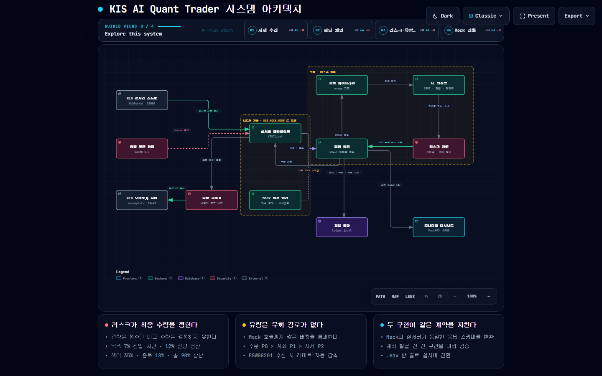

# 아키텍처

이 문서는 코드가 **어떻게 구성되어 있고 왜 그렇게 만들었는지**를 설명한다.
무엇을 사고파는지에 대한 판단 로직은 [매매전략.md](매매전략.md)에 따로 정리했다.

읽는 사람은 Python은 알지만 asyncio나 증권 API는 처음일 수 있다고 가정한다.
모르는 용어가 나오면 그 자리에서 짧게 설명하고 넘어간다.

> **인터랙티브 다이어그램**: [`architecture.html`](architecture.html) — 확대/이동, 경로 추적,
> 4개 가이드 뷰를 쓸 수 있다. 매매 중이라면 <http://127.0.0.1:8500/architecture> 에서도 열린다.



---

## 1. 이 시스템이 해결해야 하는 문제

한국투자증권(KIS) Open API로 국내 주식을 자동 매매한다. 겉보기에는 "시세를 받아서 사고팔면 되는"
단순한 일이지만, 실제로 만들어 보면 네 가지가 동시에 걸린다.

**첫째, 계좌가 없는 상태에서 개발해야 한다.** 대회 계좌는 특정 시점에 발급되는데, 그때까지
아무것도 검증하지 못하면 발급 당일에 버그를 만나게 된다. 그래서 서버 없이도 전 구간이 도는
경로를 처음부터 만들었다.

**둘째, 요청 수가 제한된다.** KIS는 계정 단위로 초당 요청 수를 제한한다(실전 20건, 모의투자 2건).
넘기면 `EGW00201` 오류가 돌아온다. 시세 조회가 몰려서 손절 주문이 거부되면 리스크 관리가 통째로
무력해지므로, 요청 순서를 통제할 수 있는 구조가 필요하다.

**셋째, 판단과 실행을 분리해야 한다.** 예측 모델이 아무리 좋아도 한 종목에 자산을 몰아넣으면
한 번의 급락으로 끝난다. 수량을 정하는 책임을 모델에서 떼어내야 한다.

**넷째, 백테스트를 믿을 수 있어야 한다.** 백테스트와 실매매가 다른 코드로 돌면, 백테스트에서
좋았던 파라미터가 실전에서 의미가 없다.

아래 구조는 이 네 가지에 대한 답이다.

---

## 2. 한 번의 루프에서 무슨 일이 일어나는가

`main.py`의 `TradingEngine._tick()`이 `LOOP_INTERVAL`(기본 3초)마다 한 번씩 실행된다.
이 함수 하나를 따라가면 시스템 전체가 보인다. 순서는 다음과 같다.

### 2.1 시세 갱신

```
_refresh_quotes()  →  self.latest_prices[종목] = 현재가
```

WebSocket이 정상이면 이 단계는 건너뛴다. 실시간 스트림이 이미 `_on_ws_quote()` 콜백으로
`latest_prices`를 갱신하고 있기 때문이다. WebSocket이 끊겼거나 Mock 모드면 REST로 조회하는데,
한 번에 전 종목을 돌지 않고 `QUOTE_CHUNK`(4개)씩 커서를 돌려가며 조회한다. 20종목을 매 루프
전부 조회하면 초당 2건 제한에 바로 걸리기 때문이다.

그다음 `_apply_latest_prices_to_panel()`이 일봉 데이터의 **마지막 행**을 현재가로 갱신한다.
당일 봉은 아직 확정되지 않았으므로, 종가 자리에 현재가를 넣어 "형성 중인 봉"을 만든다.
고가·저가도 현재가와 비교해 갱신한다.

### 2.2 평가와 리스크 상태 갱신

```
portfolio.mark_prices(prices)   → 보유 종목 평가액 갱신, 자산 고점(peak_equity) 갱신
risk.track_price(종목, 가격)      → 급락 감지용 가격 버퍼에 적재
risk.update(portfolio, now)     → NORMAL / DERISK / HALT 상태 재판정
```

`risk.update()`는 매 루프 **반드시 한 번** 호출해야 한다. 이 안에서 날짜가 바뀌었는지 검사해
`portfolio.start_new_day()`를 부르고, 그 안에서 보유 종목의 `bars_held`(보유 봉 수)가 증가한다.
이 호출을 빠뜨리면 시간 손절이 영영 작동하지 않는다.

### 2.3 신호 생성

```
signals = strategy.generate_signals(panel, holdings, now)
```

`panel`은 `{종목코드: OHLCV DataFrame}` 형태다. 전략은 이 안에서 피처를 만들고 모델을 돌려
종목마다 −1~1 점수를 매긴 `Signal` 리스트를 점수 내림차순으로 돌려준다. 자세한 계산은
[매매전략.md](매매전략.md)에 있다.

이 단계는 `try/except`로 감싸져 있다. 모델 추론에서 예외가 나도 루프는 계속 돌아야 한다.
신호가 없으면 그 루프는 청산만 하고 진입은 하지 않는다.

### 2.4 청산 심사 — 진입보다 먼저

```
exits = risk.evaluate_exits(portfolio, prices, atr_map, score_map, now)
for order in exits: await self._submit(..., Side.SELL, ...)
```

순서가 중요하다. **청산을 진입보다 먼저 처리한다.** 같은 루프에서 현금이 부족하면 팔아야 할
종목을 못 파는 상황이 생길 수 있고, 손절이 한 루프 밀리면 그만큼 손실이 커진다.

### 2.5 진입 심사

```
if risk.state == NORMAL:                        # DERISK, HALT면 진입 자체를 하지 않는다
    for sig in signals:                          # 점수 내림차순
        if sig.score < SIGNAL_BUY_THRESHOLD: break
        decision = risk.evaluate_entry(sig, portfolio, now, pending=_pending_notional())
        if decision.approved:
            await self._submit(..., Side.BUY, decision.qty, ...)
```

점수 내림차순이므로 임계값 미달이 나오면 `break`로 빠져나온다. 뒤쪽은 더 낮은 점수라 볼 필요가
없다.

`pending`은 아직 체결되지 않은 매수 주문의 평가금액이다. 이것을 넘기지 않으면 체결이 늦는 동안
같은 섹터로 주문이 연달아 나가 비중 상한이 사후적으로 무너진다(10장에서 다시 다룬다).

주문 전송 여부와 무관하게 **모든 리스크 판정은 원장에 기록된다.** 거부된 판정도 기록한다.
나중에 "왜 이때 안 샀는가"를 설명할 수 있어야 하기 때문이다.

### 2.6 체결 확인과 대조

```
_poll_fills()        → 브로커에서 신규 체결을 가져와 EventBus에 publish
_sync_portfolio()    → RECONCILE_LOOPS마다 브로커 잔고와 내부 상태 대조
_sync_open_orders()  → 미체결 잔량 동기화 + 오래된 주문 취소
_save_state()        → 상태 스냅샷을 state/engine_state.json에 저장
```

체결은 `EventBus`를 거쳐 `_on_fill_event()`에서 처리된다. 여기서 포트폴리오에 반영하고,
매도라면 실현 수익률을 리스크 매니저에 넘겨 켈리 추정 표본을 갱신하고, 매수라면 **체결가 기준
평단가로 손절선을 계산**한다.

손절선을 주문 시점이 아니라 체결 시점에 정하는 이유는, 주문을 넣는 순간에는 포지션이 아직
존재하지 않아서 평단가를 알 수 없기 때문이다. 부분체결로 평단가가 바뀔 때마다 손절선도
다시 계산된다.

---

## 3. 블록 레퍼런스 — 다이어그램을 따라 읽기

`architecture.html`의 블록 12개를 **데이터가 흐르는 순서대로** 하나씩 본다. 각 블록은
**무엇을 하는가 / 흐름 위치 / 담당 파일 / 왜 이렇게 설계했는가 / 주의점** 순서로 정리했다.

처음 읽는다면 이 절을 위에서 아래로 한 번 훑으면 전체 파이프라인이 머리에 들어온다.
블록 이름 뒤의 괄호는 다이어그램의 블록 ID다.

### 전체 흐름 한눈에

```
[외부] 토스증권 ─수집─▶ 유니버스 ─284종목─▶ 피처 ─60종─▶ AI 앙상블 ─점수─▶ 종목 선정
                                              │                              │
                                              │                         진입 후보
                                         구간별 재학습                        │
                                              ▼                              ▼
                                      백테스트·검증            리스크·규정 관문 ◀─요건─┐
                                                                             │       │
                                                                        승인 주문     │
                                                                             ▼       │
[외부] KIS 서버 ◀─REST·WS─ 브로커 ◀─우선순위─ 유량 제어기                            │
                            │                                                       │
                         체결 기록 ──────────▶ 체결 원장 ─상태─▶ 관제 화면 ──────────┘
```

| # | 블록 (ID) | 담당 파일 | 한 줄 요약 |
|---|---|---|---|
| 1 | 토스증권 Open API (`toss`) | `api/toss_data.py` | 학습용 과거 일봉·수급을 받아온다 |
| 2 | 유니버스 · 수집 (`universe`) | `scripts/refresh_universe.py`, `collect_data.py` | 규정 필터로 매매 후보 284종목을 정한다 |
| 3 | 피처 파이프라인 (`features`) | `strategy/features.py`, `flow_features.py`, `utils/indicators.py` | OHLCV·수급 → 피처 60종 |
| 4 | AI 앙상블 (`alpha`) | `strategy/ai_model.py`, `sample_weights.py` | 피처 → 점수 −1~1 |
| 5 | 종목 선정 (`select`) | `strategy/selection.py`, `phase.py` | 점수 순위로 목표 보유 종목을 정한다 |
| 6 | 리스크 · 규정 관문 (`rules`) | `strategy/risk_manager.py`, `eligibility.py` | 수량을 최종 결정하고 거부권을 가진다 |
| 7 | 유량 제어기 (`limiter`) | `core/rate_limiter.py` | 초당 요청 수를 지키며 주문을 먼저 보낸다 |
| 8 | 브로커 추상화 (`broker`) | `api/factory.py`, `base.py`, `mock_client.py`, `client.py` | Mock ↔ 실서버를 같은 인터페이스로 가린다 |
| 9 | KIS 모의투자 서버 (`kis`) | `core/websocket_client.py`, `core/auth.py` | 실제 주문·체결·시세가 오가는 외부 시스템 |
| 10 | 체결 원장 · 요건 (`ledger`) | `utils/logger.py`, `strategy/compliance.py` | 모든 체결을 남기고 대회 요건을 센다 |
| 11 | 관제 화면 (`dash`) | `monitor/app.py` | 상태를 읽기만 해서 보여준다 |
| 12 | 백테스트 · 검증 (`verify`) | `backtest/engine.py`, `walkforward.py`, `validation.py`, `scripts/ablate_exits.py` | 같은 객체로 과거를 재현해 측정한다 |

---

### 3.1 토스증권 Open API (`toss`) — `api/toss_data.py`

**무엇을 하는가** 과거 일봉(종목당 최대 1,499봉)과 투자자별 수급 데이터(65컬럼)를 받아
`data/cache/`에 CSV로 저장한다.

**흐름 위치** 파이프라인의 입구다. 출력은 유니버스 블록이 받는다.

**왜 이렇게 설계했는가** 두 가지 이유가 있다.

첫째, **학습 데이터와 매매 경로를 분리했다.** 토스는 과거 데이터만 받고, 장중 시세와 주문은
KIS로 간다. 대회 계좌가 KIS이므로 규정 논란 여지를 없애려는 선택이다.

둘째, **수급 데이터가 KIS 모의투자 도메인에 없다.** 외국인·기관 순매수, 공매도, 신용, 대차,
프로그램매매는 국내 시장에서 가격만으로는 잡히지 않는 정보다. 이것을 쓰려고 별도 수집 경로를 뒀다.

**주의점** 응답이 **중첩 JSON**이라 평탄화(`_flatten()`)가 필요하다. 처음에는 이 처리가 없어서
숫자 필드가 전부 누락됐다. 페이지네이션 커서(`before`)는 `YYYY-MM-DD`가 아니라 **완전한 ISO 8601
타임스탬프**를 요구하고, 종료 조건은 중복 제거 전의 **원본 응답 길이**로 판단해야 한다
(중복 제거 후 길이로 판단하면 399봉에서 멈춘다).

운영상 더 중요한 제약: **토스 API는 IP 화이트리스트를 쓰고 IP가 유동적이다.** 한 세션에서
IP가 네 번 바뀌어 수집이 두 번 끊겼다. 대회 기간에는 네트워크를 고정하거나 대역을 등록해야 한다.

### 3.2 유니버스 · 수집 (`universe`) — `scripts/refresh_universe.py`, `scripts/collect_data.py`

**무엇을 하는가** KRX에서 내린 CSV에 **대회 규정 필터**를 적용해 매매 후보를 정하고,
그 목록으로 토스에서 데이터를 받는다. 산출물은 `config/universe.json`이다.

**흐름 위치** 토스 ← 입력, 피처 파이프라인 → 출력(종목별 OHLCV 패널 + 수급 패널).

**어떻게 걸러내는가** 전종목 2,872개에서 순서대로 줄인다.

| 단계 | 기준 | 남는 수 |
|---|---|---|
| 전종목시세 | — | 2,872 |
| 시장 | KOSPI·KOSDAQ·KOSDAQ GLOBAL (KONEX 제외) | −107 |
| 소속부 | 관리종목·투자주의환기·SPAC·외국기업 제외 | −251 |
| 규정 | 종가 ≥ 1,000원 · 발행주식수 ≥ 10만주 · 당일 거래 발생 | −85 |
| 유동성 | 거래대금 ≥ 30억 | **284** |

앞의 세 단계는 **대회 규정**이고 마지막 하나는 **우리 판단**이다. 1억 계좌에서 단일 종목
50%는 5천만원이고, 거래대금 30억 종목이면 일거래대금의 1.7%다. 하한을 낮추면 변동성이 큰
소형주가 더 들어와 꼬리는 두꺼워지지만 슬리피지가 커져 비용 모델이 성립하지 않는다.

**왜 런타임에 받지 않는가** 지수 구성종목은 정기변경이 6월·12월 두 번뿐인 **참조 데이터**다.
장중에 조회하면 이득 없이 실패 지점만 늘어난다. 그래서 KRX CSV → JSON 변환은 수동 실행이고,
매매 런타임은 JSON만 읽는다. pykrx를 import하는 파일도 이 스크립트 하나뿐이다.

**주의점** 두 가지가 단위 문제다. 전종목시세의 `시가총액`은 **원 단위**이고 지수 구성종목
CSV의 `상장시가총액`은 **백만원 단위**다. 같은 코드로 읽으면 100만배 틀리므로 함수를 나눴다.
그리고 pykrx 1.2.9의 목록성 조회(`get_index_portfolio_deposit_file` 등)는 **KRX 계정 로그인을
요구**해 인증 없이는 빈 응답이 온다. 그래서 CSV 경로가 사실상 기본이다.

### 3.3 피처 파이프라인 (`features`) — `strategy/features.py`, `flow_features.py`, `utils/indicators.py`

**무엇을 하는가** 종목별 OHLCV와 수급 데이터를 받아 피처 60종을 만든다. 가격 44종(종목 단위
39 + 횡단면 5)과 수급 16종이다.

**흐름 위치** 유니버스 ← 입력, AI 앙상블 → 출력.

**세 종류의 피처가 왜 다 필요한가**

- **종목 단위 39종**은 그 종목만 보고 만든다. 수익률·변동성·모멘텀·거래량·가격 구조.
- **횡단면 5종**은 같은 시점 다른 종목과 비교한 상대 위치다. 시장 전체가 3% 오른 날 어떤
  종목이 3% 올랐다면 그건 알파가 아니다. 공통 변동을 제거해야 종목 고유의 초과수익이 남는다.
- **수급 16종**은 가격·거래량에 없는 정보다. 외국인·기관 순매수, 공매도 비중, 신용잔고,
  프로그램매매.

**왜 전부 인과적이어야 하는가** 백테스트는 속도를 위해 피처를 **전 구간에서 한 번** 계산한다
(`precompute`). 지표가 미래를 참조하면 그 최적화가 곧바로 룩어헤드 버그가 된다. 그래서
`selftest.py` 3번 항목이 "전 구간 계산값 == 시점별 잘라 계산한 값"을 검증한다.

**주의점** 수급 피처에는 함정이 두 개 있다.

**첫째, 시점을 늦춰야 한다.** 수급 데이터는 T일 저녁~T+4에 확정된다. T일 종가로 판단하는
시점에는 존재하지 않으므로 `FLOW_LAG_DAYS`만큼 `.shift()`한다. 0으로 두면 룩어헤드다.

**둘째, 수준값을 그대로 쓰면 종목 식별자가 된다.** 외국인 보유비중은 종목마다 고유한 값이라,
모델이 "어느 종목이 올랐는지"를 암기해 버린다. 실제로 `foreign_hold_rate`의 종목 간/종목 내
분산비가 0.927까지 나왔다. 자기 시계열 z-score로 바꿔 해결했다.

### 3.4 AI 앙상블 (`alpha`) — `strategy/ai_model.py`, `strategy/sample_weights.py`

**무엇을 하는가** 피처를 받아 **점수 하나**(−1~1)를 낸다. 세 관점을 가중 합성한다.

```
raw   = 0.5·(2p−1) + 0.3·tech + 0.2·cs      p = GBDT 상승확률
score = clip(raw × 레짐스케일, −1, 1)
```

**흐름 위치** 피처 ← 입력, 종목 선정 → 출력. 그리고 백테스트·검증 블록이 구간별로 재학습한다.

**라벨을 어떻게 만드는가 (삼중 배리어)** "5봉 뒤에 올랐는가"를 쓰면 두 가지가 틀어진다.
비용을 무시하고(0.1% 상승은 0.278% 비용을 못 넘는다), 경로를 무시한다(중간에 −5%를 찍으면
손절에 걸린다). 그래서 상단(익절)·하단(손절)·수직(기한) 세 경계를 두고 어디에 먼저 닿는지로
라벨을 정한다. 경계는 ATR 배수라 종목마다 변동성이 달라도 공평하다.

**왜 일반 K-Fold를 쓰면 안 되는가** 라벨이 미래 5봉을 본다. 무작위로 fold를 나누면 학습
샘플 t와 검증 샘플 t+3이 **같은 미래 구간을 공유**한다. 모델이 답을 이미 본 구간으로 검증하게
되어 점수가 부풀려진다. `PurgedKFold`는 시간 순서로 나눈 뒤 겹치는 학습 샘플을 제거하고,
경계 양쪽으로 `embargo`를 추가로 비운다.

**표본 가중치가 왜 필요한가** 삼중배리어 라벨은 최대 5봉을 공유하므로 중복 표본이 모델을
편향시킨다. `sample_weights.py`가 라벨의 **고유도**(겹침의 역수)를 계산해 가중치로 쓴다.

**주의점** 베팅 사이즈의 중립점은 0.5가 아니라 **라벨의 양성 비율**(`base_rate`)이다. 0.5로
두면 정상 신호가 전부 음수로 읽혀 익스포저가 4%까지 붕괴한다. 그리고 `bet == 0.0`은
"진입 금지"라는 뜻이므로 바닥값으로 덮지 않는다.

### 3.4-1 장중 돌파 감시 (`intraday`) — `strategy/intraday.py`, `strategy/minute_features.py`

**무엇을 하는가.** 목적함수가 절대수익 top10이라 `E[R]`이 아니라 `P(R ≥ 100%)`를
최대화해야 하고, 그래서 일봉 스윙에서 **장중 돌파 → 당일 청산**으로 전환했다.
`IntradayWatcher`가 시세를 받아 돌파를 감지하고 청산 시점을 판정한다.

**흐름 위치.** 시세(`2.1`) → **여기** → 리스크 관문(`3.6`) → 주문. `USE_INTRADAY=true`
면 일봉 신호 경로(`3.3`~`3.5`)는 관심목록 선정에만 쓰이고 진입은 돌파가 결정한다.

**담당 파일.**

| 파일 | 역할 |
|---|---|
| `strategy/intraday.py` | 돌파 감시·후보 명부·청산 판정. **순수 로직, 주문 없음** |
| `strategy/minute_features.py` | 돌파 사건 피처 18종(학습용) |
| `scripts/collect_minute.py` | 급등일 1분봉 수집(토스, 중단 후 이어받기) |
| `scripts/replay_intraday.py` | 하루 재연 — **같은 감시기를 그대로 구동한다** |

**트리거.**

```
① 현재가 ≥ 전일종가 × (1 + INTRADAY_TRIGGER_PCT)
② 그 분 거래량 ≥ INTRADAY_VOL_MULT × (전일 거래량 ÷ 391)
```

`Quote.volume`은 KIS `acml_vol`(누적거래량)이라 분이 바뀔 때 기준값을 잡고
**차분**으로 분당 거래량을 만든다. 가격만 보면 거래 없이 호가 몇 번에 뛴 것까지
발동한다 — 트리거를 +3%로 낮추면 그런 사건이 급격히 늘어난다(도달일 88,275일 vs
+10% 13,099일).

**왜 이렇게 설계했는가.**

- **순수 로직으로 분리했다.** 주문도 네트워크도 파일도 건드리지 않는다. 리스크
  매니저가 모든 주문의 최종 관문이라는 원칙(`3.6`)을 깨지 않기 위해서고, 덕분에
  셀프테스트에서 네트워크 없이 검증된다(17·18번).
- **점수 산정을 감시기 밖에 뒀다**(`main.py::_intraday_score`). 모델 점수와 고정
  공식(신선도)을 같은 구조에서 바꿔 끼워 비교해야 한다.
- **후보 명부를 둔다.** 발동 신호를 매 루프 비우면 같은 분에 동시 발동한 것들
  사이에서만 고르게 된다. 실측에서 2번째 돌파가 5분 안에 나는 날이 **76.9%**라
  슬롯 2개가 09:00~09:01에 차고 나머지 12건이 선택 기회조차 없이 버려졌다.
- **리플레이가 같은 감시기를 쓴다.** 재구현하면 검증이 아니라 다른 코드를
  테스트하는 것이 된다.

**주의점.**

- **Mock으로는 시각 기반 로직을 검증할 수 없다.** `_mock_epoch`에 일 단위만 더해
  가상 시각이 항상 09:00이다. 아침 스캔(09:05)·마감 정리(15:15)·신선도 경과분이
  발동하지 않거나 0으로 고정된다. 리플레이로 대신 본다.
- **날짜 롤오버에서 발동 이력·명부·교체 카운터를 비워야 한다.** 안 비우면 어제
  발동한 종목이 오늘 영원히 발동하지 않는다.
- **장중 모드에서 루프를 막는 작업 셋을 전부 떼어냈다.** 루프 간격은 3초인데
  아래 셋이 각각 수십~백수십 초를 막았다. Mock 스모크에서 70초 동안 루프가
  **1회**만 돈 적이 있다.

  | 작업 | 소요 | 조치 |
  |---|---|---|
  | 아침 후보 스캔 | 158초 | 별도 태스크(`asyncio.create_task`) |
  | 일봉 재적재 | 158초 | 장중 모드에서 비활성 — 트리거가 쓰는 일봉 입력은 전일 종가·거래량뿐이고 하루 내내 고정이다 |
  | 일봉 신호 계산 | 9~85초 | 장중 모드에서 **1회만** — 관심목록 씨앗과 사이징 보조값에만 쓰인다 |

  `_refresh_quotes()`는 `QUOTE_CHUNK=4`로 루프당 4종목씩만 돌려 안전하다.

- **전일 기준값은 `startup()`에서 한 번만 떠서 보관한다**(`_prev_daily`).
  `_apply_latest_prices_to_panel()`이 패널 마지막 봉을 실시간 가격으로 덮어쓰므로
  매번 다시 읽으면 전일 종가가 오염된다. `ts < 오늘` 필터만으로는 부족하다 —
  브로커가 당일 봉을 아직 주지 않으면 **마지막 봉이 어제 것**이고 그 행이
  덮어써져, 필터가 오염된 행을 집어 기준선이 현재가를 따라다닌다.

- **아침 스캔은 `await` 하면 안 된다.** 유니버스 284종목을 모의투자 유량(2건/초,
  안전마진 후 1.8건/초)으로 조회하면 **158초**가 걸린다. `_tick()` 안에서 await
  하면 그 2.6분 동안 돌파 감지도 청산도 처리되지 않는다 — 측정에서 이른 돌파가
  좋고(36.8분 vs 74.9분) 진입 슬리피지가 크다고 나왔으므로 09:05~09:07을 날리는
  것은 치명적이다. 별도 태스크로 띄우고 `_scanned_day`로 재진입을 막는다.
  종료 시에는 태스크를 취소한다(158초짜리 작업이라 종료가 그만큼 늦어진다).
- **청산 감시는 체결 시점에 시작한다**(`open_watch`). 접수 시점에는 평단가가 없어
  목표·손절 기준이 어긋난다(손절선을 체결 시점에 잡는 것과 같은 이유다).
- **리플레이는 실거래보다 관대하다.** 분 전체 거래량으로 판정한다(실거래는 분 중간
  누적). 반대로 진입가는 다음 분 시가로 불리하다. 두 차이가 상쇄되지 않는다.
  미체결은 모사한다(`BUY_LIMIT_BAND`, 실측 17.5%).

#### 리플레이가 모사하지 않는 실거래 요소 — 전수 점검

**리플레이에 리스크 매니저가 없다.** 그래서 `risk.evaluate_exits()`가 분봉 포지션에
적용하는 규칙이 측정에 전혀 나타나지 않는다. 점검에서 **네 개를 찾았고 전부
해제해야 했다.**

| 요소 | 기본값 | 분봉에 미치는 영향 | 조치 |
|---|---|---|---|
| `TAKE_PROFIT_PCT` | 0.09 | **상승을 9%에서 자른다** — 꼬리가 구조적으로 사라진다 | `.env`에서 0 |
| `TRAILING_ACTIVATE_PCT` | 0.025 | +2.5%만 올라도 발동 | 0 |
| `MDD_SOFT`/`HARD_LIMIT` | 0.07/0.12 | 익스포저 84%에서 쉽게 닿는다 | 1.0 |
| `DAILY_LOSS_LIMIT` | 0.03 | 보유가 평균 3.6% 내리면 **HALT + 전량 청산 + 쿨다운** | 1.0 |
| `CRASH_DROP_PCT` | 0.045 | 급등주의 정상 변동폭이다 | 0.30 |
| `SIGNAL_SELL_THRESHOLD` | −0.15 | **일봉 점수**로 장중 포지션을 청산한다(개념 불일치) | −9.9 |

남겨 둔 것: `STOP_LOSS_PCT`(0.12)는 단일 종목 붕괴를 막는 마지막 선이고 측정에서
수익을 깎지 않았다(−0.147 → 0.425). `MAX_HOLDING_BARS`는 `bars_held`가 날짜
롤오버에서만 증가하므로 당일 청산 전략에는 작동하지 않는다(inert).

**이 점검을 한 이유.** 처음 두 개(일일 손실 한도·익절)를 우연히 발견했고, 그런
것이 더 있을 수 있어 전수로 봤다. **측정에 없는 규칙은 측정이 틀렸다는 뜻이고,
실거래에서만 드러난다.** 리플레이에 리스크 매니저를 붙이는 것이 근본 해결이지만,
그러면 리플레이가 더 이상 가벼운 도구가 아니게 된다 — 지금은 해제로 맞추고
해제 사실을 설정과 문서 양쪽에 남긴다.

### 3.5 종목 선정 (`select`) — `strategy/selection.py`, `strategy/phase.py`

**무엇을 하는가** 점수 목록에서 **이번 봉에 보유할 종목**을 정한다. 신규 진입 대상과 교체
청산 대상을 각각 돌려준다.

**흐름 위치** AI 앙상블 ← 입력(점수 내림차순 목록), 리스크 관문 → 출력(진입 후보).

**왜 절대 임계값이 아니라 순위인가** 원래는 `score < 0.22`면 건너뛰는 방식이었다. 이 방식의
구조적 문제는 **임계값을 넘는 종목이 없으면 현금을 든다**는 것이다. 실측 평균 익스포저가
30%였고, 시장이 +61% 오른 구간에서 전략은 손실이었다. 현금 70%로 상승장을 이길 방법은 없다.

순위 방식으로 바꾸면 모델이 풀어야 할 문제가 "이 종목의 절대 상승확률이 0.6을 넘는가"에서
"지금 후보 중 어느 것이 가장 좋은가"로 바뀐다. 후자가 훨씬 쉽고, 확률 교정이 틀려도 순위가
맞으면 동작한다.

**회전율을 어떻게 통제하는가** 순위는 매 봉 흔들린다. 바뀔 때마다 교체하면 왕복비용 0.278%가
알파를 먹는다. 그래서 `MIN_HOLDING_BARS`만큼은 순위가 밀려도 유지한다(잠금). 잠긴 포지션이
슬롯을 차지하고, 빈 슬롯만 새 후보로 채운다.

**대회 국면이 여기에 들어온다** `phase.py`가 날짜만 보고 1단계(초기화 창이 열린 5영업일)와
2단계를 나누고, 국면별 보유 종목 수를 정한다. 1단계는 손절과 MDD 게이트를 끄는데, 근거는
**수익률 초기화가 하방을 완전히 덮는다**는 것뿐이다. 창이 닫히면 그 근거가 사라지므로
전환이 성과가 아니라 **날짜**로 일어나야 한다.

**주의점** **레짐을 종목 수에 곱하면 안 된다.** 리스크 관문이 이미 비중에 곱하므로 이중
축소가 된다. 실측 `regime.scale` 중앙값이 0.80이라 익스포저가 37.3% → **12.3%로 붕괴**하고
Sharpe가 −0.813이 됐다. 지금은 문턱값 아래에서만 절반으로 줄인다.

그리고 **백테스트와 실거래가 이 모듈의 같은 함수를 호출해야 한다.** 두 경로가 갈라지면
백테스트는 실거래를 예측하지 못하고, 그 순간 백테스트는 의미를 잃는다.

### 3.6 리스크 · 규정 관문 (`rules`) — `strategy/risk_manager.py`, `strategy/eligibility.py`

**무엇을 하는가** 모든 주문의 **최종 수량을 결정**하고 거부권을 가진다. 전략이 아무리 좋은
점수를 내도 여기를 통과하지 못하면 주문이 나가지 않는다.

**흐름 위치** 종목 선정 ← 입력(진입 후보), 유량 제어기 → 출력(승인된 주문). 그리고 체결
원장에서 요건 현황을 받는다.

**수량을 어떻게 계산하는가**

```
target_w = 변동성타게팅 × 켈리배수 × 신호강도 × 레짐
         ↓ 종목 상한 / 섹터 상한 / 총 익스포저 상한 / 가용현금으로 클립
qty      = 호가단위에 맞춘 정수 수량
```

**켈리는 상한이 아니라 배수다.** 상한으로 쓰면 거래 표본이 적을 때 상수값이 항상 이겨
변동성 타게팅이 무력화된다. 실제로 변동성 15%인 종목과 75%인 종목의 수량이 똑같이 나온
버그가 있었다.

**방어는 세 계층이다**

1. **종목 단위** — 고정 손절, ATR 트레일링, 익절, 시간 손절, 급락 감지
2. **포트폴리오** — 일일 손실 한도, MDD 2단계(소프트 축소 → 하드 전량청산), 총 익스포저 상한
3. **분산** — 단일 종목 비중, 섹터 비중

**대회 규정 판정이 함께 들어온다** `eligibility.py`가 순수 함수로 판정하고 관문이 호출한다.
현재가 1,000원 미만(매수만), 발행주식수 10만주 미만, 관리종목, KONEX, 그리고 **단일 종목
50% 한도**다. 한도는 설정값과 규정 50% 중 **작은 쪽**을 쓰므로 설정을 실수로 올려도 위반하지
않는다.

**주의점** 1,000원 미만은 **매수만** 제한한다. 매도를 막으면 보유 종목이 그 아래로 내려갔을 때
손절이 불가능해지고, 그것이 더 위험하다.

그리고 **손절폭이 변동성보다 넓어야 한다.** 이것이 이 프로젝트에서 가장 비싸게 배운
교훈이다. 손절 3.5%는 유니버스 일간 변동성 3.3%와 거의 같아, 무작위 진입에서도 10봉 내
**62.6%가 노이즈로 손절**됐다. 12%로 넓히자 out-of-sample Sharpe가 −0.147 → 0.425로 바뀌었다.

### 3.7 유량 제어기 (`limiter`) — `core/rate_limiter.py`

**무엇을 하는가** 초당 요청 수를 지키면서, 급한 요청을 먼저 보낸다. 토큰 버킷과 우선순위
큐를 합쳤다.

**흐름 위치** 리스크 관문 ← 입력(승인된 주문), 브로커 → 출력.

**왜 우선순위가 필요한가** KIS 유량은 실전 20건/초, **모의투자 2건/초**다. 시세 폴링이 몰리는
순간에 손절 주문이 큐 뒤에 밀리면 방어가 늦어진다. 그래서 **주문 P0 > 계좌 P1 > 시세 P2**로
나눈다. 시세 12건이 대기 중일 때 들어온 주문이 2번째로 처리되는 것을 셀프테스트 5번이 확인한다.

**왜 Mock까지 이 경로를 통과하는가** `MockKISClient._throttle()`도 같은 제어기를 쓴다. 그래야
실서버로 전환할 때 타이밍이 달라지지 않는다. Mock에서 잘 돌던 것이 실서버에서 유량 초과로
깨지는 상황을 막으려는 설계다.

**주의점** `EGW00201`이나 HTTP 429를 받으면 `notify_rate_limit_error()`가 레이트를 일시
감축한다. 그리고 취소된 future는 토큰을 소비하지 않아야 한다 — 그러지 않으면 타임아웃이
누적될 때 유량이 조용히 새어나간다.

### 3.8 브로커 추상화 (`broker`) — `api/factory.py`, `api/base.py`, `api/mock_client.py`, `api/client.py`

**무엇을 하는가** Mock 체결 엔진과 실제 KIS 서버를 **같은 인터페이스**로 가린다.
`create_broker()`가 `USE_MOCK_MODE`를 보고 어느 쪽을 돌려줄지 정한다.

**흐름 위치** 유량 제어기 ← 입력, KIS 서버 → 출력. 체결은 원장으로 간다.

**왜 이 추상화가 전체 설계의 축인가** 계좌 발급 전에는 Mock으로 전체 파이프라인을 검증하고,
발급 후에는 **코드 수정 없이** 실서버에 붙어야 한다. 그래서 두 구현이
`AbstractBroker`를 따르고 **동일한 KIS JSON 스키마**(`rt_cd`/`msg_cd`/`msg1`/`output*`)를
반환한다. 상위 레이어는 어느 쪽인지 모른다.

TR_ID도 같은 원칙이다. `settings.tr("order_buy")`가 환경을 보고 모의 `VTTC0802U` 또는 실전
`TTTC0802U`를 돌려준다. 호출부에 TR_ID 문자열을 하드코딩하면 이 전환이 깨진다.

**주의점** 브로커에 메서드를 추가할 때는 **Mock과 실클라이언트 양쪽에 동시에** 구현해야
한다. 그리고 Mock은 실제 KIS 응답 필드명을 그대로 흉내내야 한다 — `base.py`의 파서가
양쪽에 공용이기 때문이다.

### 3.9 KIS 모의투자 서버 (`kis`) — `core/websocket_client.py`, `core/auth.py`

**무엇을 하는가** 실제 주문·체결·시세가 오가는 외부 시스템이다. REST와 WebSocket 두 경로를 쓴다.

**흐름 위치** 브로커 ← 주문, 브로커 → 체결·시세.

**WebSocket이 왜 필요한가** REST 시세 폴링은 유량을 먹는다. WebSocket으로 체결가(H0STCNT0)와
호가(H0STASP0)를 구독하면 폴링 없이 실시간 가격을 받는다. 체결통보(H0STCNI0/H0STCNI9)는
AES-256-CBC로 암호화되어 오므로 복호화가 필요하다.

**구독 한도가 설계를 제약한다** 세션당 **41건**(체결+호가 합산)이다. 유니버스가 284종목이면
전부 구독할 수 없다. 그래서 신호 계산용 유니버스와 실시간 시세용 **관심목록**을 분리한다
(§3.11 관련). 관심목록은 보유 종목을 먼저 넣고 남는 자리를 점수 상위로 채운다 — 손절 판단이
현재가에 달려 있어서 보유 종목의 시세가 밀리면 방어가 늦어진다.

**인증** OAuth 2.0 client_credentials로 토큰을 받고 24시간 쓴다. 디스크에 캐시해 재시작할
때마다 재발급하지 않는다. WebSocket은 별도의 `approval_key`가 필요하다.

**주의점** 모의투자 도메인은 실전과 TR_ID가 다르고 **일부 순위·조건검색 API를 지원하지
않는다.** 그래서 실시간 스크리닝 대신 사전 정의된 유니버스에서 일봉 기반으로 추린다.

### 3.10 체결 원장 · 요건 (`ledger`) — `utils/logger.py`, `strategy/compliance.py`

**무엇을 하는가** 모든 주문·체결·리스크 판정을 `logs/ledger.jsonl`에 append-only로 남기고,
그 기록에서 **대회 최소 자격 요건**을 센다.

**흐름 위치** 브로커 ← 체결, 관제 화면 → 상태. 그리고 요건 현황이 리스크 관문으로 되돌아간다.

**왜 JSON Lines인가** append-only라 쓰기 중 손상 위험이 적고, 한 줄이 한 사건이라 사후 분석이
쉽다. 백테스트와 실매매가 **같은 포맷**을 쓰므로 분석 스크립트를 한 벌만 유지한다.
그리고 대회 근거자료로도 쓸 수 있다.

**요건을 왜 코드가 세는가** 네 가지를 못 채우면 **수익률과 무관하게 실격**이다.

| 요건 | 기준 |
|---|---|
| OpenAPI 거래 횟수 | 5회 이상 |
| 매매금액 | 5억원 이상 |
| 매매일수 | 5영업일 이상 |
| 매매 종목수 | **코스피200·코스닥150 중** 5종목 이상 |

마지막 항목이 특히 중요하다. 유니버스가 284종목으로 넓어졌으니 지수 외 종목만 거래하다
이 요건을 놓칠 수 있다. 그래서 전체 종목 수가 아니라 **지수 멤버십**으로 센다.

**주의점** 요건이 빠듯해지면 `MIN_HOLDING_BARS`를 줄여 회전을 늘린다. 거래비용보다 실격이
비싸기 때문이다. 그리고 **수익률 초기화가 거래 실적까지 초기화하는지는 확인이 필요하다** —
그렇다면 집계 시작일을 초기화 시점으로 옮겨야 한다(`since` 인자가 그 대비다).

### 3.11 관제 화면 (`dash`) — `monitor/app.py`

**무엇을 하는가** 자산·낙폭·포지션·신호·유량, 그리고 대회 국면과 요건 충족 현황을 2초마다
보여준다.

**흐름 위치** 체결 원장 ← 상태 스냅샷. 출력은 사람이 본다.

**왜 읽기만 하는가** 화면이 죽어도 매매는 영향받지 않아야 한다. `state_snapshot()` 콜백으로
상태를 읽기만 하고 아무것도 바꾸지 않는다. uvicorn은 매매 루프와 **같은 이벤트 루프**에서
태스크로 돈다.

**화면 규칙** 등락 색은 국내 관습을 따른다 — **상승 빨강, 하락 파랑**. 초록은 가격이 아니라
"시스템이 살아 있다"는 신호로만 쓴다. 화면의 주인공은 낙폭 게이지다.

**대회 영역** 기간 중에는 국면 배너와 **수익률 초기화 권고 배너**, 4개 요건 진행률이 상단에
뜬다. 초기화는 되돌릴 수 없는 1회성 계좌 설정 변경이라 **코드가 실행하지 않는다** — 권고만
띄우고 사람이 KIS 화면에서 수행한다.

**주의점** 이 화면은 `main.py`가 돌 때만 떠 있다. `/architecture` 경로도 같다 — 다이어그램
HTML은 자체 완결형이라 파일을 직접 열어도 된다.

### 3.12 백테스트 · 검증 (`verify`) — `backtest/engine.py`, `walkforward.py`, `validation.py`, `scripts/ablate_exits.py`

**무엇을 하는가** 과거 데이터로 같은 전략을 재현해 성과를 측정하고, 그 숫자가 운인지 실력인지
교차 검증한다.

**흐름 위치** AI 앙상블 ← 구간별 재학습. 출력은 사람이 읽는 리포트다.

**왜 실매매와 같은 객체를 쓰는가** `BacktestEngine`이 실매매와 **동일한**
`EnsembleAlphaStrategy`/`RiskManager` 인스턴스를 주입받는다. 전략·리스크 로직을 고치면 양쪽에
동시에 반영되므로 백테스트-실거래 불일치가 구조적으로 생기지 않는다.

**룩어헤드를 어떻게 막는가** 봉 t의 종가까지로 판단하고 체결은 **봉 t+1의 시가**에서 이뤄진다.
갭하락은 손절가가 아니라 시가에 체결된다. `MarketSimulator`는 커서 이후 데이터를 노출하지 않는다.

**왜 30봉 구간 워크포워드인가** 대회가 30거래일이다. 구간마다 과거만 보고 재학습해 평가
구간을 이어 붙이면, 대회 기간 중 실제로 어떻게 돌아갈지에 가장 가까운 숫자가 나온다.
단일 백테스트 Sharpe는 실제의 두 배까지 부풀려진다.

**절제 실험** `ablate_exits.py`가 구간당 학습 1회로 여러 설정을 동시에 평가한다. 출구 규칙은
학습에 쓰이지 않으므로 설정마다 재학습하는 것은 낭비다(실측 구간당 학습이 전체 시간의 95%).

**주의점** 세 가지가 측정을 조용히 망친다.

**첫째, 한 번에 하나씩 바꾼다.** 묶어 넣으면 좋아져도 나빠져도 무엇이 기여했는지 알 수 없고,
그 상태로 파라미터를 맞추면 그것이 곧 과적합이다. 이 프로젝트에서 세 번 겪었다.

**둘째, 데이터 지문을 확인한다.** 같은 설정이 데이터 재수집 전후로 Sharpe 0.873과 0.263으로
갈린 일이 있다. 그래서 실행마다 패널 지문을 기록하고, **지문이 다른 실행의 수치는 비교하지
않는다.** 비교 대상은 수급 사용 여부도 같아야 한다.

**셋째, DSR의 `trial_sharpes`에는 서로 다른 설정의 Sharpe만 넣는다.** CPCV 분할별 Sharpe는
같은 설정의 기간별 변동이므로 넣으면 기준선만 부풀려 지표가 무의미해진다.

---

## 4. 왜 asyncio인가

이 시스템의 병목은 CPU가 아니라 **네트워크 대기와 요청 수 제한**이다. 피처 계산은 20종목 기준
수십 밀리초면 끝나지만, REST 요청 하나는 수백 밀리초가 걸리고 초당 2건까지만 보낼 수 있다.

이런 작업에는 스레드보다 단일 이벤트 루프가 다루기 쉽다. 이유는 두 가지다.

**요청 순서를 한곳에서 통제할 수 있다.** 스레드 여러 개가 각자 요청을 보내면 "지금 주문을 먼저
보내라"를 강제하기 어렵다. 단일 루프에서는 모든 요청이 하나의 대기열을 통과하므로 우선순위를
줄 수 있다.

**공유 상태에 락이 거의 필요 없다.** 포트폴리오, 미체결 주문, 가격 캐시를 여러 태스크가
건드리지만, `await`로 명시적으로 양보하는 지점 사이에서는 다른 코드가 끼어들지 않는다.
경쟁 상태를 만들 수 있는 구간이 `await` 앞뒤로 한정되므로 추론하기 쉽다.

### 동시에 도는 태스크

| 태스크 | 생성 위치 | 하는 일 |
|---|---|---|
| 메인 루프 | `TradingEngine.run()` | `_tick()` 반복 |
| 이벤트 버스 | `EventBus.start()` | 큐에서 이벤트를 꺼내 핸들러 호출 |
| 토큰 갱신 | `TokenManager.start_auto_refresh()` | 만료 30분 전 선제 재발급 |
| 유량 디스패처 | `PriorityRateLimiter._run()` | 토큰이 생기면 우선순위대로 대기자 깨우기 |
| WebSocket | `KISWebSocketClient.start()` | 수신 루프 + 자동 재연결 |
| 대시보드 | `DashboardServer.start()` | uvicorn 서버 |

### 예외가 루프를 죽이지 않게 하는 방식

비동기 프로그램에서 가장 흔한 사고는 **태스크 하나가 조용히 죽는 것**이다. `asyncio.Task` 안에서
예외가 나면 그 태스크만 종료되고, 아무도 `await`하지 않으면 로그조차 남지 않는다.

이 프로젝트는 세 겹으로 막는다.

1. `_tick()` 전체를 `run()`에서 `try/except`로 감싸고, 실패하면 지수 백오프 후 다음 루프로 간다.
   연속 실패해도 최대 30초까지만 대기한다.
2. `EventBus._consume()`은 핸들러를 **하나씩 개별 `try/except`로** 호출한다. 구독자 하나가
   예외를 던져도 나머지 구독자는 정상 수신한다. 셀프테스트 10번 항목이 이 동작을 검증한다.
3. `_tick()` 내부에서도 신호 생성, 시세 조회처럼 실패해도 진행 가능한 단계는 개별로 감싼다.

---

## 5. 유량 제어 — `core/rate_limiter.py`

### 토큰 버킷

토큰 버킷은 일정 속도로 증가하는 카운터다. 요청 하나가 토큰 하나를 소비하고, 토큰이 없으면
생길 때까지 대기한다.

```python
경과시간 = now - last
tokens = min(capacity, tokens + 경과시간 * rate)   # 연속 리필
if tokens >= 1: tokens -= 1; 통과
else:           (1 - tokens) / rate 만큼 대기
```

`capacity`(버스트 허용량)가 있어서 잠깐 몰리는 요청은 그대로 통과하고, 지속적으로 몰리면
`rate`로 수렴한다. 시간 측정에 `time.monotonic()`을 쓴다. 시스템 시계가 바뀌어도 영향을 받지
않아야 하기 때문이다.

### 우선순위 큐

토큰 버킷만으로는 "주문이 시세보다 먼저"를 보장할 수 없다. 그래서 대기자를 힙에 넣고 토큰이
생길 때마다 우선순위가 가장 높은 대기자를 깨운다.

```
PRIORITY_ORDER    = 0   신규주문 · 정정취소
PRIORITY_ACCOUNT  = 1   잔고 · 주문가능 조회
PRIORITY_QUOTE    = 2   시세 조회
PRIORITY_BACKGROUND = 3 사전 데이터 적재
```

구현상 주의할 점이 두 가지 있다.

**취소된 대기자는 토큰을 소비하면 안 된다.** 힙에서 꺼낸 Future가 이미 취소되었으면 토큰을
반납하지 않고 다음 대기자로 넘어간다.

**대기자가 없으면 디스패처는 `Condition.wait()`로 잠든다.** 그렇지 않으면 유휴 상태에서 CPU를
계속 태운다.

검증: 시세 요청 12건이 대기 중일 때 주문을 넣으면 **2번째로** 처리된다(셀프테스트 5번 항목).

### 적응형 백오프

서버가 `EGW00201`이나 HTTP 429로 유량 초과를 알리면 `notify_rate_limit_error()`가 호출된다.
이때 토큰을 0으로 비우고 일정 시간 동안 레이트를 절반으로 낮춘다. 페널티 중에 또 초과가 나면
페널티 시간을 두 배로 늘린다(최대 60초).

**Mock 클라이언트도 같은 유량 제어를 통과한다.** 실서버로 바꿨을 때 타이밍이 달라지지 않게
하려는 의도다. Mock에서만 빠르게 돌면, Mock에서 검증한 루프 주기가 실서버에서는 성립하지 않는다.

---

## 6. 인증 — `core/auth.py`

접근토큰은 발급 후 24시간 유효하다. 세 가지를 처리해야 한다.

**짧은 간격의 재발급이 거부된다.** KIS는 직전 발급으로부터 일정 시간이 지나지 않으면 새 토큰을
주지 않는다. 그래서 토큰을 `.tokens/token_{env}.json`에 저장하고, 프로세스를 재시작해도
남은 유효시간이 충분하면 그대로 재사용한다. **개발 중에 이 디렉토리를 지우고 반복 재시작하면
발급이 막힌다.**

**만료 직전에 끊기면 안 된다.** 백그라운드 태스크가 만료 30분 전에 미리 재발급한다. 주문을
보내려는 순간에 토큰 발급부터 하게 되면 그만큼 지연된다.

**동시 호출이 중복 발급을 일으키면 안 된다.** `asyncio.Lock`으로 감싸서, 여러 태스크가 동시에
토큰을 요청해도 실제 발급은 한 번만 일어난다.

WebSocket은 접근토큰이 아니라 별도의 `approval_key`를 쓴다. `POST /oauth2/Approval`로 받는다.

---

## 7. 브로커 추상화 — `api/`

### 인터페이스가 지키는 계약

`api/base.py`의 `AbstractBroker`가 인터페이스를 정의한다. 구현체는 두 개다.

- `api/client.py`의 `KISClient` — 실제 KIS 서버와 통신
- `api/mock_client.py`의 `MockKISClient` — 내부 가상 호가·체결 엔진

두 구현은 **완전히 동일한 JSON 스키마**를 반환한다. KIS 응답의 공통 규약은 다음과 같다.

```json
{ "rt_cd": "0",            // "0"이면 성공
  "msg_cd": "MCA00000",    // 메시지 코드 (EGW00201 = 초당 거래건수 초과)
  "msg1": "정상처리 되었습니다.",
  "output": { ... } }      // 또는 output1 / output2
```

`base.py`의 파서(`_chart_rows_to_frame`, `get_portfolio_state`, `submit_order`)를 양쪽이
공유하므로, Mock이 실제 KIS 필드명을 그대로 흉내내지 않으면 실서버 전환 시 깨진다.

**브로커에 메서드를 추가할 때는 반드시 양쪽에 동시에 구현해야 한다.** 이것이 이 프로젝트에서
가장 지키기 쉬우면서 가장 어기기 쉬운 규칙이다.

### TR_ID 분기

KIS는 같은 기능이라도 실전과 모의투자의 TR_ID가 다르다. 호출부에 문자열을 직접 쓰면 환경을
바꿀 때 전부 찾아 고쳐야 하므로, `config/settings.py`의 `tr()` 메서드가 논리적 이름을 받아
환경에 맞는 코드를 돌려준다.

```python
settings.tr("order_buy")   # 모의 VTTC0802U / 실전 TTTC0802U
settings.tr("inquire_balance")  # VTTC8434R / TTTC8434R
settings.tr("inquire_price")    # FHKST01010100 (시세는 공통)
```

### Mock 체결 엔진이 재현하는 것

단순히 "즉시 전량 체결"로 만들면 검증 가치가 없다. 실제로 겪는 상황을 재현한다.

- 지정가/시장가, 미체결 잔량, **부분체결**(기본 25% 확률로 잔량의 30~70%만 체결)
- 호가단위 위반 거부(`40230000`), 가격제한폭 이탈(`40260000`), 주문가능금액 부족(`40310000`),
  보유수량 초과 매도(`40320000`)
- 매수 수수료, 매도 수수료 + 증권거래세, 스프레드 기반 슬리피지
- 임의 주문거부(기본 1%) — 예외 처리 경로가 실제로 도는지 확인하려는 목적

시세는 `backtest/data.py`의 `MarketSimulator`가 공급한다. 커서가 가리키는 시점 이후의 데이터는
절대 노출하지 않으므로, Mock 경로에서 미래 정보를 참조하는 것이 구조적으로 불가능하다.

---

## 8. 데이터 계약

여러 모듈이 주고받는 자료구조는 고정되어 있다. 이것만 알면 어느 모듈이든 읽을 수 있다.

### OHLCV DataFrame

```
컬럼: ts, open, high, low, close, volume
ts  : 문자열 "YYYYMMDD"
정렬: 과거 → 최신 (KIS 응답은 최신 → 과거이므로 base.py에서 뒤집는다)
```

전 구간이 이 스키마를 쓴다. 합성 데이터 생성기, 로컬 CSV 로더, KIS 차트 응답 파서가 모두 같은
형태를 만들어 내므로 데이터 출처를 바꿔도 하위 코드는 그대로다.

### 도메인 객체 — `core/events.py`

| 객체 | 의미 | 만드는 곳 |
|---|---|---|
| `Quote` | 현재가 스냅샷 | 브로커, WebSocket |
| `Signal` | 종목별 알파 점수(−1~1)와 근거 | 전략 |
| `RiskDecision` | 승인 여부, 수량, 손절가, 사유 | 리스크 매니저 |
| `OrderRequest` / `OrderAck` | 주문 요청과 접수 응답 | 엔진 / 브로커 |
| `Fill` | 체결 1건 (수수료·세금 포함) | 브로커 |
| `Position` | 보유 포지션, 고점 추적 포함 | 포트폴리오 |
| `Portfolio` | 현금 + 포지션 + 누적 통계 | 엔진, 백테스터 |

`@dataclass(slots=True)`로 정의했다. `slots=True`는 인스턴스에 `__dict__`를 만들지 않아
메모리와 속성 접근 비용을 줄인다. 매 루프 수십~수백 개가 만들어지는 객체라 의미가 있다.

`Position`은 `peak_price`(보유 중 최고가)를 계속 갱신한다. 트레일링 스톱이 이 값을 기준으로
계산되기 때문이다.

### 이벤트 버스

`asyncio.Queue` 기반의 토픽 구독 구조다. 큐가 가득 차면 **가장 오래된 이벤트를 버리고** 새
이벤트를 넣는다. 시세 데이터는 최신성이 중요하므로, 밀린 과거 이벤트를 붙잡고 있는 것보다
버리는 쪽이 낫다. 버린 개수는 `dropped`에 누적되어 관측 가능하다.

---

## 9. 백테스트와 실매매의 관계 — `backtest/engine.py`

### 같은 객체를 공유한다

`BacktestEngine`은 실매매와 **동일한** `EnsembleAlphaStrategy`와 `RiskManager` 인스턴스를
주입받는다. 전략이나 리스크 로직을 고치면 양쪽에 동시에 반영되므로, "백테스트에서는 되는데
실전에서 다르게 동작하는" 불일치가 구조적으로 생기지 않는다.

갈라지는 지점은 두 곳뿐이다.

| | 백테스트 | 실매매 |
|---|---|---|
| 신호 | `precompute()` + `signals_at(i)` | `generate_signals()` |
| 레짐 | `regime_series()` — 봉별 배열 | `detect_regime()` — 현재 시점 |

판정 규칙은 `_classify_regime()` 하나를, 점수 조립은 `_make_signal()` 하나를 공유한다.
즉 갈라지는 것은 **계산 시점**이지 **계산 내용**이 아니다.

### 왜 사전계산이 가능한가

백테스트에서 매 봉마다 피처를 다시 계산하면 O(n²)이 된다. 1,200봉 × 20종목이면 실용적이지 않다.

그런데 `utils/indicators.py`의 모든 지표는 **인과적(causal)** 이다. 즉 시점 t의 값은 t까지의
데이터만으로 결정된다. 따라서 전 구간에서 한 번 계산한 배열의 t번째 원소와, 0~t까지 잘라서
계산한 결과의 마지막 원소가 **정확히 같다.** 이 성질 덕분에 전 구간을 한 번만 계산하고
인덱스로 참조할 수 있다.

셀프테스트 3번 항목이 이것을 직접 검증한다.

```python
full   = rsi(close, 14)        # 전 구간
prefix = rsi(close[:200], 14)  # 앞 200개만
assert np.allclose(full[:200][~nan], prefix[~nan])
```

**이 성질이 깨지면 사전계산 최적화가 곧바로 룩어헤드 버그가 된다.** 지표를 추가할 때는 이
검증을 반드시 통과시켜야 한다.

### 룩어헤드를 막는 세 지점

1. 지표의 인과성 (위)
2. **체결 시점**: 봉 t의 종가로 판단하고 봉 t+1의 **시가**에 체결한다. 종가로 판단해서 종가에
   체결하는 백테스트는 실제로는 불가능한 거래를 가정한 것이다.
3. **갭 처리**: 봉 t+1의 저가가 손절선을 깨면 그 봉에서 청산하되, 체결가는 `min(시가, 손절가)`로
   잡는다. 갭하락으로 시작하면 손절가에 팔 수 없고 시가에 팔리기 때문이다.

### 비용 모델

```
매수: 체결가 × (1 + 슬리피지) , 수수료 1.4bp
매도: 체결가 × (1 − 슬리피지) , 수수료 1.4bp + 증권거래세 15bp
```

왕복 비용은 약 0.278%다. 이 값은 `settings.round_trip_cost`로 계산되며, 라벨링 임계값에도
그대로 쓰인다. 비용을 넘지 못하는 예측은 맞아도 손해이기 때문이다.

---

## 10. 상태 관리와 복구

실매매 프로그램은 중간에 죽을 수 있고, 죽은 뒤에 다시 떠야 한다. 세 가지를 다룬다.

### 브로커 잔고와의 대조

내부 포트폴리오는 체결 이벤트를 누적해서 만든다. 그런데 체결 통보를 놓치거나 네트워크가
끊기면 내부 상태와 실제 계좌가 어긋난다. `RECONCILE_LOOPS`마다 `_sync_portfolio()`가
브로커 잔고를 조회해 대조하고, **불일치하면 브로커 값을 신뢰한다.** 내부 계산보다 거래소에
기록된 수량이 사실이기 때문이다.

### 부분체결과 미체결 추적

`self.open_orders`는 주문번호를 키로 미체결 주문을 들고 있다. 체결이 들어오면 **잔량만 차감**
하고, 잔량이 0이 될 때만 제거한다. 첫 부분체결에서 바로 제거하면 아직 잔량이 남아 있는데도
추적이 사라져 같은 종목에 중복 주문이 나간다.

`_sync_open_orders()`는 브로커의 미체결 잔량과 내부 추적을 맞추고, 180초가 지난 주문은
취소한다. 호가에서 멀어진 지정가를 방치하면 자금이 묶인 채로 다음 기회를 놓친다.

### 재시작 복구

`state/engine_state.json`에 자산 고점(`peak_equity`) 등을 저장한다. 재시작할 때 이 값을
복구하지 않으면 낙폭이 0%로 리셋되어, 이미 손실 구간에 있는데도 MDD 방어가 풀린다.

포지션 자체는 저장하지 않는다. 기동 시 `_sync_portfolio(initial=True)`가 브로커에서 실제
잔고를 읽어 복구하는 쪽이 정확하다.

### 종료 시퀀스

`SIGINT`/`SIGTERM`을 받으면 미체결 주문을 취소하고, 남은 체결을 수집하고, 상태를 저장한 뒤
리소스를 정리한다. 정리 단계는 하나가 실패해도 나머지가 계속 진행되도록 개별로 감쌌다.

Windows의 기본 이벤트 루프는 `add_signal_handler()`를 지원하지 않으므로, 실패하면
`signal.signal()`로 대체한다.

---

## 11. 로깅과 관측

### 두 가지 로그를 분리한다

**사람이 읽는 로그**는 `logs/trader.log`에 남는다. loguru가 설치되어 있으면 쓰고, 없으면
같은 API(`bind`, `success`, `exception`)를 제공하는 표준 `logging` 래퍼로 자동 대체된다.
어느 쪽이든 호출부 코드는 같다.

**기계가 읽는 원장**은 `logs/ledger.jsonl`에 JSON Lines로 쌓인다. 한 줄이 하나의 이벤트다.

| 이벤트 | 담는 내용 |
|---|---|
| `risk_decision` | 종목, 점수, 승인 여부, 수량, 사유, 사이징 내역 |
| `order` / `order_reject` | 주문 내용, 거부 시 메시지 코드 |
| `fill` | 체결가, 수량, 수수료, 세금, 실현손익, 사유 |
| `exit` | 청산 사유(손절/트레일링/익절/시간/킬스위치) |
| `risk_state` | 상태 전환과 그때의 자산·낙폭 |

거부된 판정까지 남기는 것이 핵심이다. 대회 리포트에서 "왜 이 종목을 샀고 왜 저 종목은 안 샀는가"를
건별로 설명할 수 있다.

### 관제 화면

`monitor/app.py`가 FastAPI 앱을 만들고 **매매 루프와 같은 이벤트 루프에서** uvicorn 태스크로
돈다. 별도 프로세스가 아니므로 상태를 공유하기 위한 IPC가 필요 없다. 상태는 엔진이 주입한
콜백(`state_snapshot`)으로만 읽으므로, 화면이 죽어도 매매는 영향을 받지 않는다.

| 경로 | 용도 |
|---|---|
| `/` | 관제 화면 |
| `/architecture` | 구조 다이어그램 |
| `/health` | 프로세스 감시 |
| `/api/state` | 전체 상태 JSON |
| `/metrics` | Prometheus 텍스트 포맷 |

---

## 12. 의존성 전략

`lightgbm`과 `loguru`는 있으면 쓰고 없으면 대체한다.

```python
try:
    import lightgbm as lgb
    HAS_LGB = True
except Exception:
    HAS_LGB = False
```

`HAS_LGB`가 False면 `sklearn.ensemble.HistGradientBoostingClassifier`를 쓴다. 둘 다 히스토그램
기반 GBDT라 하이퍼파라미터 의미가 거의 대응된다. 로거도 마찬가지로 동일한 인터페이스를 제공하는
래퍼를 둔다.

기술적 지표는 TA-Lib 대신 `utils/indicators.py`에 numpy로 직접 구현했다. TA-Lib은 C 확장이라
Windows에서 빌드가 까다롭고, 환경마다 설치 여부가 갈리면 "내 컴퓨터에서는 되는데"가 생긴다.

결과적으로 **추가 설치 없이 그대로 실행된다.**

---

## 13. 코드를 읽는 순서

처음 보는 사람이 전체를 파악하려면 이 순서를 권한다.

1. **`config/settings.py`** — 시스템이 다루는 모든 값이 여기 있다. 필드 이름만 훑어도 무엇을
   통제하는 시스템인지 감이 온다.
2. **3장 블록 레퍼런스** — 12개 모듈이 각각 무엇을 맡는지. 어디를 열어야 할지 정해진다.
3. **`core/events.py`** — 모듈 간에 오가는 자료구조. 이걸 알면 나머지 코드의 타입이 읽힌다.
4. **`main.py`의 `_tick()`** — 한 루프의 전체 흐름. 위 2장을 옆에 두고 따라가면 된다.
5. **`strategy/risk_manager.py`의 `evaluate_entry()`** — 수량이 결정되는 지점. 이 시스템에서
   가장 중요한 함수다.
6. **`core/rate_limiter.py`** — 비동기 동기화 기법(Condition, Future, 힙)이 압축되어 있다.
7. **`backtest/engine.py`의 `run()`** — 시간이 어떻게 전진하고 체결이 어떻게 일어나는지.
8. **`scripts/selftest.py`** — 각 모듈이 무엇을 보장하는지가 검증 코드에 그대로 쓰여 있다.
   사실상 실행 가능한 명세서다.

## 14. 직접 고쳐 보기

공부 목적이라면 다음 순서로 손대 보면 구조가 몸에 익는다.

**지표 하나 추가하기.** `utils/indicators.py`에 함수를 쓰고, `strategy/features.py`의
`build_features()`에서 컬럼을 만들고, `BASE_FEATURES`에 이름을 추가한다. 그다음
`python scripts/selftest.py`로 인과성 검증을 통과하는지 확인하고, `train_model.py`로 재학습해
피처 중요도에서 몇 등인지 본다.

**청산 규칙 추가하기.** `RiskManager.evaluate_exits()`에 조건을 넣는다. 우선순위 순서(§매매전략)를
지켜야 한다. 새 `ExitReason` enum 값도 추가한다.

**브로커 메서드 추가하기.** `AbstractBroker`에 추상 메서드를 선언하면 Mock과 실클라이언트 양쪽에
구현하지 않는 한 인스턴스 생성 자체가 실패한다. 이것이 의도된 안전장치다.

**유량 한도 바꿔 보기.** `.env`의 `REST_RATE_LIMIT`을 0.5로 낮추고 `main.py`를 돌리면 주문이
어떻게 밀리는지, 대시보드의 대기열 수치가 어떻게 변하는지 관찰할 수 있다.

---

## 15. 개발 중 실제로 잡은 버그

구현하면서 실행을 통해 발견한 결함들이다. 비슷한 시스템을 만들 때 같은 함정을 피할 수 있다.

**켈리 비중이 변동성 타게팅을 가렸다.** 포지션 크기를 `min(변동성타게팅, 켈리)`로 계산했는데,
거래 표본이 적을 때 켈리가 상수(0.1)로 고정되어 항상 이 값이 선택됐다. 변동성이 15%인 종목과
75%인 종목의 수량이 똑같이 나왔다. 켈리를 상한이 아니라 **배수**로 바꿔서 해결했다.
`수량 ∝ 변동성타게팅 × 켈리배수`.

**부분체결 시 중복 진입.** 첫 부분체결에서 주문 추적을 제거해, 잔량이 남아 있는데도 같은 종목에
새 주문이 나갔다. 잔량이 0이 될 때만 제거하도록 고쳤다.

**손절선이 설정되지 않았다.** 주문 접수 시점에 `positions[symbol]`을 찾아 손절선을 넣으려 했는데,
그 시점에는 포지션이 아직 없어서 `None`이었다. 체결 이벤트에서 평단가 기준으로 계산하도록 옮겼다.

**스칼라를 배열 함수에 넘겼다.** `detect_regime()`에서 `safe_div(스칼라, 스칼라)`를 호출했는데
이 함수는 배열을 반환한다. numpy 2.x에서 길이 1 배열을 `float()`로 변환하면 `TypeError`가 난다.
백테스트는 `regime_series()`를 쓰기 때문에 실시간 루프를 돌리기 전까지 드러나지 않았다.
**단위 테스트만으로는 부족하고 실제로 돌려 봐야 한다는 사례다.**

**킬스위치가 매 봉 진동했다.** Mock에서는 1봉이 1거래일이라 "새 거래일이면 킬스위치 해제" 규칙이
매 봉 발동했다. 낙폭이 여전히 한도를 넘는데도 `HALT → NORMAL → HALT`를 반복해서, 청산 직후
재진입이 가능한 상태가 됐다. 새 거래일에는 **일일 손실 한도만 리셋**하고 낙폭은 별도로 판정하도록
분리했다.

**미체결 주문이 한도 계산에서 빠졌다.** 체결이 늦는 동안 같은 섹터로 주문이 연달아 나가 IT 비중이
상한 35%를 넘어 45.6%까지 쌓였다. 진입 심사에 미체결 주문의 평가금액을 넘겨 '보유 예정'으로
세도록 고쳤다.

### 측정을 망친 버그들 — 코드는 돌지만 결론이 틀렸던 사례

위의 버그들은 예외나 명백한 오작동으로 드러났다. 아래는 **조용히 틀린 결론을 만든** 것들이라
더 위험하다.

**학습 구간과 평가 구간이 겹쳤다 (in-sample 함정).** `train_model --source data/cache` 뒤에
`run_backtest --source data/cache`를 돌려 Sharpe 3.456, 수익 +904%가 나왔다. 같은 데이터로
학습하고 평가한 것이다. 합성 데이터에서는 `--days 1500`과 `--days 1200`이 서로 다른 난수
시계열을 만들기 때문에 이 문제가 드러나지 않았다. 실데이터로 바꾸자 같은 파일을 읽어
겹쳤다. `AlphaModel.train_range`를 저장하고 `run_backtest`가 겹침을 경고하도록 고쳤다.
**진짜 성과는 워크포워드 −0.663이었다.**

**레짐을 두 번 곱했다.** `selection.py::target_count()`가 보유 **종목 수**에 `regime.scale`을
곱했는데, `RiskManager.evaluate_entry()`가 이미 **비중**에 같은 값을 곱한다. 실측 중앙값이
0.80이라 5종목 의도가 4종목이 되고, 19.9% 구간에서는 2종목 이하로 줄었다. 익스포저가
37.3% → **12.3%로 붕괴**하고 Sharpe가 −0.813이 됐다. **즉 그 실험은 Top-K라는 발상을
측정한 것이 아니라 버그를 측정한 것이었다.** 곱셈을 문턱값으로 바꿔 해결했다.

**절대 하한이 짧은 패널을 전부 걸러냈다.** `align_panel`은 공통 날짜의 **교집합**을 잡으므로
상장이 늦은 종목 하나가 전체 구간을 잘라낸다(신규 상장이 섞이면 수십 봉으로 붕괴). 그래서
`MIN_HISTORY_BARS=750`을 넣었는데, 구간이 530봉인 절제 실험에서 **40종목 전부가 제외**되어
모든 수치가 0.00%로 나왔다. 하한을 `min(설정, 중앙값×0.9)`로 완화해 "다른 종목보다 유독
짧은 종목"만 걸러내도록 고쳤다.

**비교 조건이 달랐다.** 수급 데이터를 새로 수집하는 중에 절제 실험을 돌렸더니 25종목만
수급 피처가 채워졌다. 기준선은 수급 **없이** 측정한 값이라 직접 비교가 불가능했다.
**설정을 비교할 때는 데이터 조건도 같아야 한다**(`--no-flow` / `--flow-dir`).

**합성·장기 결과를 대회 길이에 옮겼다.** 600봉 합성 데이터에서 "MDD 소프트 리밋 7%가
익스포저를 묶는 지배적 제약"으로 보였다(11.6% → 62.8%). 그런데 실데이터 30봉 구간에서는
MDD 한도를 완화한 설정이 기준선과 **소수점까지 동일**했다 — 30봉 안에서는 낙폭이 리밋까지
쌓이지 않는다. 평가 구간 길이가 결론을 뒤집는다.

**실거래 루프가 이미 한계를 넘고 있었다.** 일봉 전략인데 매 루프(3초)마다
`generate_signals()`를 호출했다. 실측 20종목 **5.63초**, 116종목 17.83초로 루프 간격을
이미 초과했다. 일봉은 장중에 바뀌지 않으므로 같은 계산을 반복한 것이다. 봉이 바뀔 때만
재계산하도록 캐시를 넣었다(26루프에 7회). **성능 문제는 예외를 던지지 않으므로 측정해야
드러난다.**

**수급 피처 16종이 학습에 전혀 쓰이지 않았다.** `backtest/walkforward.py::train_on_bars()`가
`build_panel_features(sub)`를 **수급 없이** 호출했다. 그러면 모델이 수급 피처를 전부
NaN으로 보고 학습한다. 그 상태로 백테스트에서만 수급을 채우면 학습과 추론의 입력 분포가
달라져(train/serve mismatch) 도움이 되기는커녕 해롭다. 즉 **수급 수집·피처 구현
전체가 워크포워드 경로에서 죽어 있었다.**

`train_on_bars`와 `segment_returns`, `run_walkforward`에 `flow_panel`을 관통시켜 고쳤다.
그리고 절제 실험에서 수급을 **설정 차원**으로 다루도록 바꿨다 — 수급 모드마다 모델을
따로 학습해야 학습·평가가 같은 입력을 본다(`scripts/ablate_exits.py`의 `_use_flow`).

교훈: **피처를 추가했다고 모델이 그것을 본다는 보장이 없다.** 학습 경로와 추론 경로가
같은 입력을 받는지 따로 확인해야 한다. 이 결함은 예외도 경고도 내지 않았다.

**늦게 상장한 소수 종목이 평가 구간을 8분의 1로 줄였다.** `align_panel`은 공통 날짜의
교집합을 잡는다. 284종목 유니버스에서 이력 하한을 750봉으로 두면 239종목이 남지만
**교집합이 764봉**이 되어 30봉 구간이 8개뿐이다. 하한을 1350으로 올리면 219종목
(239의 92%)에 1,353봉 — **구간이 28개**다. 종목 20개를 포기해 평가 표본을 3.5배로
늘리는 거래다. 늦게 상장한 종목 몇 개가 전체를 지배하므로 하한을 높이는 쪽이 유리하다.

**`--symbols` 기본값이 유니버스 설정을 조용히 덮었다.** 기본이 40이라
`UNIVERSE_FILE`로 284종목을 설정해 둬도 앞 40개만 측정됐다. 로그에는 "35종목"이
찍혔지만 의도는 284였다. 기본값을 0(전체)으로 바꿨다. **"안전한 기본값"이 설정을
무력화하면 안전하지 않다.**

**데이터가 조용히 바뀌어 실험 간 비교가 무효가 됐다.** 같은 설정이 이틀 사이에
**Sharpe 0.873 / +33.2% 와 0.263 / +7.0%** 로 갈렸다. 21구간 전부 불일치했다.
원인을 좁히며 다음을 확인했다.

| 검증 | 방법 | 결과 |
|---|---|---|
| 모델 결정성 | 동일 프로세스에서 2회 학습해 예측 해시 비교 | 지문·AUC·트리 수까지 일치 |
| 평가 구간 가격 | 두 실행의 구간별 벤치마크 수익률 비교 | 21/21 완전 일치 |
| 코드 등가성 | 이전 코드 상태를 재현해 같은 구간 재측정 | 현재 코드와 같은 값 |

**코드도 시드도 평가 구간 가격도 같았다.** 남는 것은 학습 구간 데이터였고, 그 사이
수집이 40종목을 재수집했다. 이전 스냅샷이 없어 확정은 못 했다.

핵심은 **왜 조용했는가**다. 벤치마크는 수익률(비율)만 보므로 가격 수준이 배수로 바뀌어도
값이 같다. 그래서 "데이터는 같다"고 오판했다. 대응으로 `scripts/ablate_exits.py`가
실행마다 **패널 지문**(정렬된 close의 해시 + 종목수·봉수·기간)을 로그와 JSON에 남기고
"지문이 다른 실행과는 비교할 수 없다"를 명시한다.

이 과정에서 **바이섹트를 한 번 잘못 짚었다.** 커밋되지 않은 익절 비활성화 가드를
모르고 파일을 HEAD로 되돌렸더니 `TAKE_PROFIT_PCT=0.0`이 "수익 0% 이상 즉시 익절"로
해석됐다. 그 상태의 측정값은 무의미했다. **되돌려 비교할 때는 되돌린 코드가 현재
설정값을 어떻게 해석하는지 확인해야 한다.**

**수급 데이터가 없는데 조용히 학습했다.** `scripts/train_model.py`는 `--source` 아래
`flow/`를 자동으로 읽는데, 못 찾으면 **아무 말 없이** 기술 피처만으로 학습했다. 끄는
플래그도 없었다. 그래서 수급을 켠 줄 알고 돌린 학습이 실제로는 꺼져 있었는지 로그로
구분할 수 없었다. `--no-flow`를 명시적 스위치로 추가하고, **디렉토리를 못 찾으면
경고를 띄우도록** 고쳤다. 같은 종류의 침묵이 `train_on_bars`의 `flow_panel` 누락을
한 달 동안 가린 원인이다.

**다른 유니버스의 AUC를 비교하려 했다.** 40종목 모델(AUC 0.5987)과 284종목 모델의
AUC는 **비교 대상이 아니다.** 종목 집합이 바뀌고(기존 40 중 8개가 규정 필터에 걸려
284에 없다), 표본이 7배가 되고, 삼중배리어 양성비율 자체가 달라진다. 라벨 모집단이
다른 두 AUC의 차이는 모델 품질 차이가 아니다. 유효한 비교는 **같은 유니버스에서
피처 축 하나만 움직이는 것**이고, 유니버스 효과는 AUC가 아니라 같은 실행 내 수익률로
판정한다. 백테스트에 지문을 붙인 것과 같은 이유다.

`.env`가 `UNIVERSE_FILE`을 주입하고 있으면 `--symbols 40`도 함정이다. 284종목 중 앞
40개를 집는데 기존 40종목과 교집합이 **6개뿐**이다. `UNIVERSE_FILE= python ...`으로
환경변수를 비워 `DEFAULT_UNIVERSE`로 폴백시켜야 같은 종목을 본다.

**같은 코드가 +0.557%와 −0.442%로 갈렸다 — 수집이 돌아가는 중에 측정했다.**
분봉 리플레이에서 후보 명부 TTL을 30분 → 1분으로 고쳤는데 성과가 더 나빠졌다.
TTL을 0·1·2·5분으로 스윕하니 **네 값이 전부 동일**했다 — 명부가 원인이 아니었다.
원인은 그 사이 수집이 계속 돌아 같은 종목의 **추가 급등일**이 들어온 것이었다
(571MB → 985MB). 날짜별 후보 풀이 달라져 선택이 바뀌었다. 두 실행 모두
"178종목 · 20250917~20260929"로 보였기 때문에 코드 차이를 몇 시간 뒤졌다.
`ablate_exits.py`가 바로 이 이유로 지문을 찍는데 **리플레이에 넣지 않아 같은
함정을 다시 밟았다.** 지금은 리플레이도 지문을 찍는다. **수집이 진행 중이면
측정하지 않는다.**

**403을 종목 오류로 취급해 "완료"로 끝냈다.** `collect_minute.py`가 403(IP 화이트
리스트 거부)을 만나면 그 종목만 빠져나가고 다음 종목으로 넘어갔다. 403은 전역
이므로 나머지도 같은 403을 맞고, 루프만 돌다 `logger.success`로 "완료"를 찍었다 —
실제로는 88,275일 중 **19,887일(23%)**만 받았는데 성공으로 보였다. 403이 454회
찍혀 있었다. 지금은 전역 중단 + 종료코드 2 + 잔여량 보고를 한다.

**속도를 위해 넣은 사전 분할이 메모리를 3.5GB 먹었다.** 리플레이가 날짜 루프 안에서
DataFrame을 필터링해 O(일수 × 종목수 × 전체행수)가 되어 10분이 지나도 끝나지
않았다. 그래서 전 날짜를 `{분ts: 튜플}` 사전으로 미리 분할했는데, 985MB 분봉에서
**3.5GB**를 써서 다른 작업이 메모리 부족으로 죽었다(파이썬 객체 오버헤드가 원본의
몇 배다). 이분탐색 색인으로 바꾸니 배열만 들고 날짜 구간을 O(log n)으로 잘라 쓰며
실행이 몇 분에서 **5초**로 줄었다. **그 과정에서 `bars.clear()` 뒤에 `for sym in
bars`가 남아 전일 종가가 전부 0이 되고 거래 0건이 나왔다** — 자료구조를 바꿀 때는
그것을 참조하는 모든 지점을 찾아야 한다.

**지정가 0.4%로 매수가 절반 가까이 체결되지 않았다.** `_submit()`이 매수·매도 모두
0.4%를 쓰고 있었다. 실측 33,482 돌파 사건에서 매수 체결률이 **61.5%**였고, 못 사는
38.5%가 하필 "가격이 빠르게 뛴 급등" — 측정에서 가장 좋았던 집단(속도 상위군
26.5분 vs 하위군 61.8분)을 골라서 놓치고 있었다. 2.0%로 열면 체결률 85.7%,
체결가는 0.19%p만 불리하다(지정가는 **상한**이고 대부분 그보다 싸게 체결된다).
매도는 현재가 **아래**로 걸어 양보하는 쪽이라 0.4%에서 99.71%로 충분하다.

여기서 **틀린 추론을 하나 했고 측정으로 잡혔다.** "백테스트는 1분 지연이고 실거래는
3초이니 슬리피지가 훨씬 작을 것"이라고 봤는데, 같은 분 안의 고가로 재니 중앙
**+0.810%**로 오히려 더 컸다. 급등은 연속이 아니라 **점프**로 움직여서 지연을 0초로
줄여도 호가 몇 단계를 뛰어넘는다.

**신선도가 상수인 줄 알았다 — 진입한 것만 보고 있었다.** 리플레이 진단에서
`trig_minute`가 전부 1분으로 나와 "트리거 +3%가 신선도를 무력화했다"고 판단했다.
사건 전체로는 상위 25% 36.8분 vs 하위 75% 74.9분으로 **차이 50.9%의 강한 신호**였다.
진단 수치를 **진입한 표본에서만** 모았기 때문이고, 슬롯이 09:00에 차서 진입 표본이
전부 이른 돌파였다. 진단은 **모집단과 선택된 표본을 구분해서** 찍어야 한다.

**측정 하네스에 체크포인트가 없어 세 번 전손했다.** `scripts/ablate_exits.py`는 모든
구간이 끝난 뒤에만 JSON을 쓴다. 가용 메모리가 2.4GB인 환경에서 측정이 세 번 중단됐고
(8/31 · 5/28 · 14/31) 매번 수 시간이 사라졌다. 로그에도 **첫·마지막 설정만** 찍혀
중간 설정은 복구할 수 없었다. 장시간 측정 도구는 **구간마다 부분 결과를 디스크에
남겨야 한다** — 중단은 예외가 아니라 정상 경로로 다뤄야 한다.

**Mock 가상시계가 시각 의존 로직을 전혀 밟지 않았다.** Mock은 봉 1개를 1거래일로
전진시키므로 `_now()`가 항상 09:00을 돌려준다. 그래서 09:05 아침 스캔·15:15 마감 정리·
신선도의 경과분이 **Mock에서 한 번도 실행되지 않았고**, 리플레이는 `IntradayWatcher`만
구동해 `main.py`의 배선을 보지 않는다. 즉 10/12 실계좌가 첫 검증이 될 상황이었다.
`MOCK_MINUTES_PER_LOOP`(기본 0, 테스트 전용)이 0보다 크면 `_now()`가 커서 대신
루프 수 x 분으로 전진한다. 이것으로 아침 스캔 발동 · 마감 후 진입 차단 ·
**마감 정리의 실제 전량 매도**를 처음 확인했다.

**그 분 스테핑은 자정을 그대로 통과한다.** `should_flatten()`은 `HHMM` 문자열 비교이므로
가상시각이 23:30을 지나 00:00이 되면 다시 `"0000" < "1515"`가 되어 진입이 재개된다.
처음 `--duration 200`으로 돌렸을 때 진입이 **익일 00:00에** 나고 15:15에 닿기 전에 런이
끝나 `청산 거래 0회`가 찍혔고, 이것을 코드 버그로 오해해 청산 경로를 뒤졌다. 실제로는
런 길이 문제였다 — 루프당 약 3.5초, 30분 스텝에서 진입 이후 15:15까지 31루프가 더 필요하다.
**시각 의존 테스트는 "그 시각에 도달했는가"를 먼저 확인해야 한다.**

---

## 16. 관련 문서

- [매매전략.md](매매전략.md) — 피처, 라벨링, 모델, 앙상블, 사이징, 청산 규칙
- [`../README.md`](../README.md) — 설치와 실행, 계좌 발급 후 전환 절차
- [`../CLAUDE.md`](../CLAUDE.md) — 코드를 고칠 때 지켜야 하는 불변 조건
- [`architecture.html`](architecture.html) — 인터랙티브 다이어그램

다이어그램을 다시 만들려면 `docs/architecture.spec.json`을 고친 뒤:

```bash
node <archify>/bin/archify.mjs validate architecture docs/architecture.spec.json --quality showcase
node <archify>/bin/archify.mjs deliver  architecture docs/architecture.spec.json docs/architecture.html --quality showcase
```

> 다이어그램 뷰어의 UI 문구(Export, Present 등)는 영어로 고정되어 있다. 본문 내용은 한국어다.
